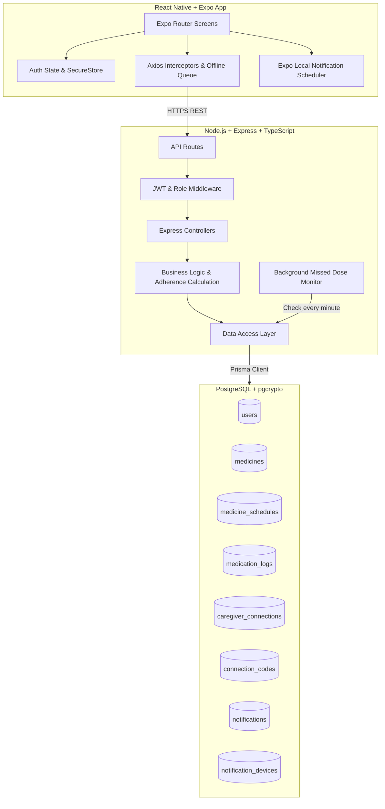

# MediCircle Architecture Documentation

## 1. System Overview

MediCircle is a full-stack mobile healthcare platform designed for smart medication reminders, schedule compliance tracking, and synchronized caregiver management.



---

## 2. Layered Backend Design

```
Route -> Controller -> Service -> Repository / Prisma -> PostgreSQL
```

- **Routes (`src/routes/`)**: Declares API routes, hooks validation middlewares (`Zod`), and checks authentication/role permissions (`authenticate`, `requireRole`).
- **Controllers (`src/controllers/`)**: Handles request parameters, HTTP status responses, and error propagation.
- **Services (`src/services/`)**: Enforces business logic (e.g. hashing passwords with bcrypt, calculating adherence percentages, validating caregiver access, generating random connection codes).
- **Repositories (`src/repositories/`)**: Encapsulates all Prisma database operations, transactions, and queries.
- **Scheduled Jobs (`src/jobs/`)**: Cron tasks that execute at regular intervals to detect expired doses and dispatch caregiver alerts.

---

## 3. Mobile Client Architecture

- **Expo Router**: File-system-based routing with typed layouts and role protection:
  - `(auth)`: Login, registration, password recovery, and onboarding walkthrough.
  - `(patient)`: Home dashboard, medication CRUD, scheduling, history, caregiver connection codes, profile.
  - `(caregiver)`: Connected patients overview, read-only medication regimens, adherence scores, missed-dose alert inbox.
- **Expo SecureStore**: Encrypted on-device storage for JWT access tokens.
- **Centralized Axios Client**: Automatic bearer token attachment, 401 unauthenticated redirect handlers, and error normalizers.
