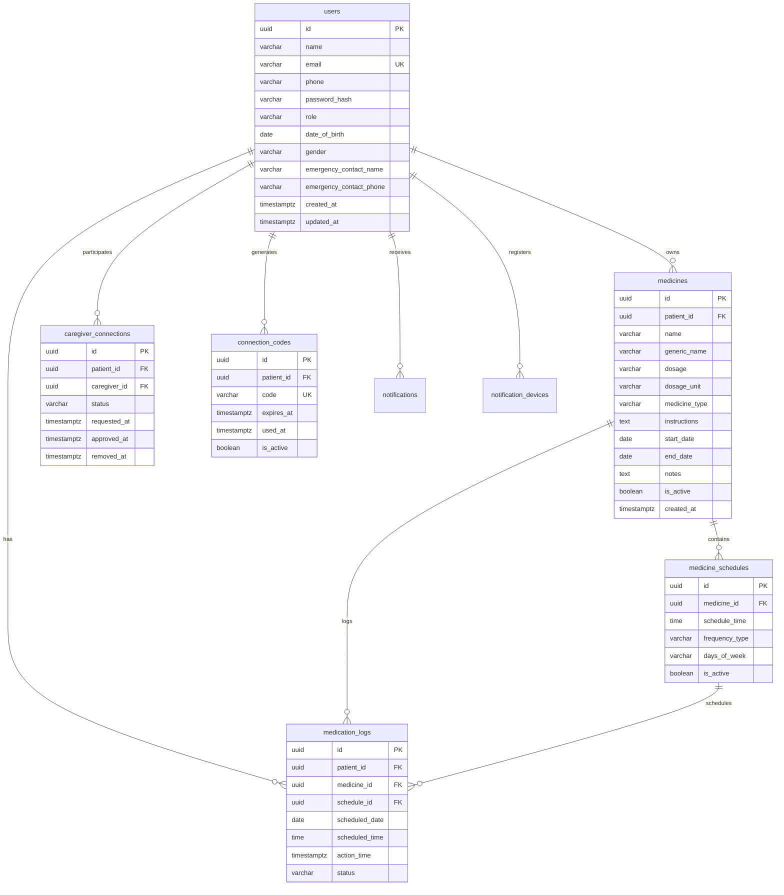

# MediCircle Database Documentation

## 1. Entity-Relationship Model

---

## 2. Table Specifications & Indexes

| Table | Primary Key | Critical Indexes | Key Constraints |
|---|---|---|---|
| `users` | `id` (UUID) | `idx_users_email` | `UNIQUE(email)`, `CHECK(role IN ('PATIENT', 'CAREGIVER'))` |
| `medicines` | `id` (UUID) | `idx_medicines_patient_id` | Foreign Key `patient_id -> users(id)` (CASCADE) |
| `medicine_schedules` | `id` (UUID) | `idx_medicine_schedules_medicine_id` | Foreign Key `medicine_id -> medicines(id)` (CASCADE) |
| `medication_logs` | `id` (UUID) | `idx_medication_logs_patient_id`, `idx_medication_logs_scheduled_date`, `idx_medication_logs_status` | `UNIQUE(patient_id, medicine_id, schedule_id, scheduled_date, scheduled_time)` |
| `caregiver_connections` | `id` (UUID) | `idx_caregiver_connections_patient_id`, `idx_caregiver_connections_caregiver_id` | `UNIQUE(patient_id, caregiver_id)`, `CHECK(patient_id <> caregiver_id)` |
| `connection_codes` | `id` (UUID) | `idx_connection_codes_code` | `UNIQUE(code)` |
| `notifications` | `id` (UUID) | `idx_notifications_user_id`, `idx_notifications_is_read` | `CHECK(type IN (...))` |
| `notification_devices` | `id` (UUID) | None | `UNIQUE(user_id, push_token)` |
